# Build guide – margin-and-financing-lab, Phase 1

**Date:** 18 Nov 2026  
**Starting point:** an empty repository and a written specification for a three-module model: a transparent margin proxy (M1), a prime-broker allocation optimiser (M2) and PM usage attribution with an illustrative internal charge (M3).  
**Goal:** allocate a synthetic multi-asset hedge-fund book across four synthetic prime brokers at minimum financing-plus-margin-funding cost, attribute the resulting margin to portfolio managers, and report every pre-registered output, whatever it shows. Tests and expected behaviour are fixed before the model code.

Boundary: synthetic data; the margin proxy is not a portfolio-margin model and is not calibrated to any prime broker, exchange or clearing house; the charge policy is illustrative; the model is not validated (see [`README.md`](README.md) and [`docs/MODEL_DOC.md`](docs/MODEL_DOC.md) §11–§12).



## Build order at a glance

| Step | What | Rule it follows | Commit(s) |
|---|---|---|---|
| 1 | Pre-registration | Model, tests, parameters and E1–E5 fixed first | `8f4dcbd` |
| 2 | Synthetic data + provenance | Data reviewed before any model code | `bb729a9`, `0044c69` |
| 3 | Package skeleton | Plumbing only | `a9d620f` |
| 4 | Hand-worked example + tests A1–A4 | Tests before code | `7971853`, `10f7341` |
| 5 | M1 margin proxy (+ speed fix D-02) | | `3fd132b`, `8b3f4f5` |
| 6 | Test A5 → M2 optimiser | Tests before code | `0774571`, `14a1266` |
| 7 | Tests A6 → M3 attribution (+ D-03) | Tests before code | `4fe56b2`, `5ce9d22`, `971fac2` |
| 8 | Tests X1–X3 → exhibits (+ D-04, D-05) | Tests before code | `ed36c85`, `0d204f3`, `e211dec` |
| 9 | Load, report, CLI, DuckDB SQL | Plumbing tests P1–P11 | `ddc2f32`, `5fdef70` |
| 10 | Exchange-margin sanity check A7 + CI | Band fixed before the exchange figure was read (D-06) | `b28fea6` |
| 11 | Input contract at load, model document, A8 | D-07, D-08 | `2603261`, `d38b765`, `4fa2e37` |
| 12 | Primary run + RESULTS.md | Every number copied by script | `11f9b95` |
| 13 | This guide + README status | | (this commit) |

Who did what: model code (M1–M3, exhibits), acceptance tests and the hand-worked example – the author. Load/report/CLI code, DuckDB SQL, plumbing tests and CI – an AI coding assistant working from written briefs, reviewed by the author. Synthetic CSVs – generated by an AI assistant to written realism rules, then reviewed row by row and checked by script. The model document was drafted with AI assistance and reviewed and edited by the author.

---

## Step 1 – Pre-registration
**What.** [`prereg/PREREGISTRATION.md`](prereg/PREREGISTRATION.md): purpose and boundary, data contract, M1–M3 formulas, acceptance tests A1–A7 with the hand-worked target values, parameters for the primary run, every output to be reported, expected behaviour E1–E5, and Phase 2 scope. README boundary paragraph and a [`data/SOURCES.md`](data/SOURCES.md) skeleton in the same commit.  
**Why.** An optimiser can be tuned until its output looks sensible. Fixing the model, the tests and the expected behaviour first means the results are reported as found, and every later change has to be logged in [`prereg/DEVIATIONS.md`](prereg/DEVIATIONS.md).  
**Design choices.**

| Choice | Decision | Reason |
|---|---|---|
| Netting | Per prime broker only; no cross-PB netting | Each PB margins its own account |
| Volatility buckets | Absolute cut-offs 10% / 20% annualised; multipliers 1.0 / 1.3 / 1.8 (assumptions) | Transparent and testable |
| Concentration | Account-relative: add-on when issuer gross G(g,p) > 0.25 · G(p) | Keeps the proxy linear and degree-1 homogeneous, so usage and Euler splits are well defined |
| PM usage | Fixed-allocation leave-one-out is primary; re-solve is a sensitivity exhibit | The charge should not depend on re-optimising someone else's book |
| Calibration | Synthetic parameter-recovery exercise moved to Phase 2 | It shows recovery mechanics, not calibration to a real provider |

**Result.** Clarifications C1–C4 and A1 target values (case a M = 3,353,400; case b M = 5,858,100) committed before any code.  
**Committed.** `8f4dcbd`

## Step 2 – Synthetic data and provenance
**What.** Nine CSVs in [`data/raw/`](data/raw/): 10 PMs, 44 issuers, 77 products, 4 PBs, 214 positions, 924 rate rows, 176 borrow rows, 9,669 prices, plus `params.csv`. Each value carries a provenance tag in [`data/SOURCES.md`](data/SOURCES.md), with a revision log.  
**Why.** The optimiser is only interesting if some constraints bind; the data must be realistic enough to test that, without any real book.  
**Issues and fixes.**
- A pre-run LP feasibility check showed three of four counterparty limits binding even at minimum margin – the problem was close to infeasible. Limits scaled × 1.25 (logged in SOURCES); afterwards only PB_B binds under the cost objective.
- The same check showed financing spreads dominate the objective at a liquidity premium ℓ = 100 bps (objective 21.88m → 21.71m when limits rose 25%). Decision before any model code: add ℓ ∈ {100, 300, 500} bps to the sensitivity grid – **D-01**.
- Line endings pinned to LF (`.gitattributes`) so CSV hashes match on every OS.

**Committed.** `bb729a9`, `0044c69`

## Step 3 – Package skeleton
**What.** `pyproject.toml` (src layout, package `mfl`), test folders, path fixtures in `tests/conftest.py`.  
**Committed.** `a9d620f`

## Step 4 – Hand-worked example and tests A1–A4 (before model code)
**What.** [`docs/HAND_WORKED_EXAMPLE.md`](docs/HAND_WORKED_EXAMPLE.md) traces two small cases by hand: per-PB gross and net, family margin, concentration threshold and add-on, buffer, then leave-one-out and solo books. Tests:

| Test | Checks |
|---|---|
| A1 | Hand-worked M, usage, solo margin and residual to the cent |
| A2a–g | Invariants on random allocations: zero at zero, non-negative, monotone in size, bucket order, convexity, degree-1 homogeneity, determinism |
| A3 | Offsetting long/short in one family at one PB lowers margin |
| A4 | No netting across PBs |

**Trip point.** In case a, PB X holds gross 36m (equity 16m + bond 20m), so the threshold is 0.25 × 36m = 9m and the issuer add-on is 0.02 × (16m − 9m) = 140,000. The bond counts in G(p) although it is not concentration-eligible. Leave-one-out also moves the threshold, because it depends on all gross left at that PB – the reason a PM's usage can in principle be negative (E4).  
**Committed.** `7971853`, `10f7341`

## Step 5 – M1 margin proxy
**What.** [`src/mfl/margin.py`](src/mfl/margin.py): volatility bucket from 60 daily log returns, family margin per PB, concentration add-on, 1.15 buffer.

```text
FM(f,p)     = r(f,p) · [φ · net(f,p) + (1 − φ) · gross(f,p)]
add-on(g,p) = c_p · max(0, G(g,p) − θ_p · G(p))
M(p)        = 1.15 · (Σ_f FM(f,p) + Σ_g add-on(g,p));   M = Σ_p M(p)
```

**Issue and fix.** Each margin call rebuilt the rate index with pandas merges (~12 ms per call); the acceptance suite took ~110 s. `build_index(...)` now builds the index once and `margin_by_pb` / `total_margin` evaluate with NumPy only – suite ~110 s → ~3 s, formulas and assertions unchanged (A1 to the cent; objective 21,714,337.24 unchanged) – **D-02**.  
**Result.** A1–A4 pass.  
**Committed.** `3fd132b`, `8b3f4f5`

## Step 6 – M2 allocation optimiser (A5 first)
**What.** Test A5 (capacity, counterparty and borrow constraints, infeasible-block diagnosis, tightness) committed before [`src/mfl/optimise.py`](src/mfl/optimise.py). Linear programme in cvxpy solved with HiGHS: decision variable w(i,p) ∈ [0,1], Σ_p w(i,p) = 1; objective = financing cost + margin funding cost in USD over a 90-day horizon (ACT/360).  
**Design choices.**
- The concentration `max(0, ·)` term enters the LP through an epigraph variable (`conc_addon ≥ G(g,p) − θ_p · G(p)`), so the problem stays linear.
- Reported margin is always recomputed from w* by `margin.py`, never read from solver variables.
- If the LP is infeasible, a slack version names the constraint blocks that cannot be met.
- Duals are reported as sensitivity signals only; under degeneracy they may be non-unique.

**Result.** A5 passes; solver status optimal on the synthetic book.  
**Committed.** `0774571`, `14a1266`

## Step 7 – M3 attribution (A6 first)
**What.** Tests A6a–c and the A1 share/charge assertions committed before [`src/mfl/attribution.py`](src/mfl/attribution.py): leave-one-out usage u_k at w*, solo margin, residual R = M − Σ u_k shared by solo-margin share, charge = attributed margin × pass-through × H/360. `validate_rates` rejects base_rate ≤ 0 and φ outside [0, 1), which proves the zero-denominator case can only arise from an empty book.  
**Issue and fix.** Review found that a PM left out of an explicit `pm_ids` list fell silently into R and was charged to the others; Σ still equalled M, so no check fired. `pm_usage` now rejects it – **D-03** (test written after the code, hence logged).  
**Committed.** `4fe56b2`, `5ce9d22`, `971fac2`

## Step 8 – Exhibits: re-solve usage, all-in cost, Euler (X1–X3 first)
**What.** [`src/mfl/exhibits.py`](src/mfl/exhibits.py): usage with the PM removed and the rest re-optimised; all-in cost (financing + margin funding) per PM; Euler allocation with kink detection.  
**Issues and fixes.**
- The pre-registered sentence "Euler sums to M except at kinks" was inexact: for a convex degree-1 homogeneous proxy every subgradient sums to M; kinks make the per-PM split non-unique. Corrected wording, and each PM's Euler value is reported with a [low, high] range – **D-04**.
- The omitted-PM gap from D-03 applied to Euler too; fixed, plus a check that Euler values sum to M – **D-05**.

**Committed.** `ed36c85`, `0d204f3`, `e211dec`

## Step 9 – Load, report, CLI and SQL
**What.** [`src/mfl/io.py`](src/mfl/io.py), [`src/mfl/cli.py`](src/mfl/cli.py), [`src/mfl/report.py`](src/mfl/report.py) and the DuckDB views in [`sql/`](sql/): one command writes `run_meta.json`, `results/*.csv`, `tables/*.csv` and `report.html`. Plumbing tests P1–P11, including `margin_detail` vs `margin_by_pb` agreement within 1e-6 on random allocations, and rate validation on load.  
**Committed.** `ddc2f32`, `5fdef70`

## Step 10 – Exchange-margin sanity check (A7) and CI
**What.** A7 compares the proxy for `IRSF_10Y` with CBOT 10-Year T-Note futures initial margin (public CME figure, source and dates in [`data/public/exchange_margin.csv`](data/public/exchange_margin.csv)). Band 0.5–4.0, fixed before the exchange figure was checked – **D-06**. GitHub Actions CI on Python 3.11 and 3.14.  
**Result.** Ratios 1.69–2.74 at the four PBs, all inside the band. A screen for unit and scale errors, not calibration.  
**Issue.** The CI files were already staged, so they went into the A7 commit and a separate CI commit came out empty. Lesson: run `git status --short` before every commit.  
**Committed.** `b28fea6`

## Step 11 – Input contract at load, model document, A8
**What.**
- Review of the model document draft found that several pre-registered load checks were promised but not enforced (θ and c domains, product/issuer/locate combinations, concentration flags, position validity, provenance tags). `io.py` now rejects inputs outside the contract, with plumbing tests for each rejection – **D-08**.
- [`docs/MODEL_DOC.md`](docs/MODEL_DOC.md): 15 sections in model-risk-management vocabulary (purpose and use, conceptual soundness, outcomes analysis, limitations, validation status, monitoring).
- A8 checks the model document carries the validation-status sentence exactly once and its headings in order – **D-07**.

**Committed.** `2603261`, `d38b765`, `4fa2e37`

## Step 12 – Primary run and RESULTS.md
**What.** `python -m mfl.cli run --seed 42` at `4fa2e37`; outputs committed in [`reports/run_42/`](reports/run_42/); [`RESULTS.md`](RESULTS.md) reports every pre-registered output with every number copied from the run CSVs by script.  
**Result.** The 26 output CSVs are byte-identical to an earlier run at `ddc2f32` (the commits in between changed validation, report display, docs and tests only).  
**Committed.** `11f9b95`

---

## Scorecard

| Item | Result | Where |
|---|---|---|
| Tests | 81 passed (`-W error`); CI green | `tests/`, Actions |
| Solver | optimal; objective 21,714,337 USD over 90 days | RESULTS §1 |
| Binding constraints | counterparty at PB_B; capacity nowhere; 48 borrow limits | RESULTS §3 |
| Attribution | Σ attributed − M = 2.38e-07 USD; residual 15.9% of M | RESULTS §5 |
| Euler | Σ Euler = M; 40 net kinks → ranges reported | RESULTS §6 |
| Exchange sanity (A7) | 4 of 4 ratios inside 0.5–4.0 | RESULTS §8 |
| Expected behaviour | E2, E3, E5 confirmed; E4 not confirmed; E1 not confirmed as stated | RESULTS §9 |
| Reproducibility | 26 CSVs byte-identical across two commits | RESULTS header |
| Deviations | 8 logged (D-01 – D-08), none changes the primary results | `prereg/DEVIATIONS.md` |

## Lessons
1. Check LP feasibility on the synthetic data before freezing it – it found near-infeasible limits and the financing-dominated objective before any model code existed.
2. A sum-to-total check does not catch a missing participant: an omitted PM's margin moved into the residual and the totals still matched. Validate the participant list explicitly.
3. Pre-registered mathematical statements need the same review as code (the Euler sentence, D-04).
4. A promised validation is not done until a test fails without it (D-08).
5. Profile before optimising: one prebuilt index cut the suite from ~110 s to ~3 s without touching a formula.
6. Copy reported numbers by script and keep run outputs in the repo, so every figure can be traced to a file.

## Next (Phase 2)
- Re-solve with borrow limits relaxed, to isolate why hedged families split (E1).
- Fixed-horizon stress: volatility shock, haircut increase, one PB invoking notice; margin-call and excess-liquidity projection.
- Synthetic calibration exercise: hidden parameters plus noise, NNLS recovery, recovery error.
- MILP variant.

## Reproduce
```bash
git clone https://github.com/kakali-bandyopadhyay/margin-and-financing-lab.git
cd margin-and-financing-lab
python -m venv .venv
# Windows: .venv\Scripts\Activate.ps1   |   macOS/Linux: source .venv/bin/activate
python -m pip install -e ".[dev]"
python -m pytest -W error -q
python -m mfl.cli run --seed 42
```
